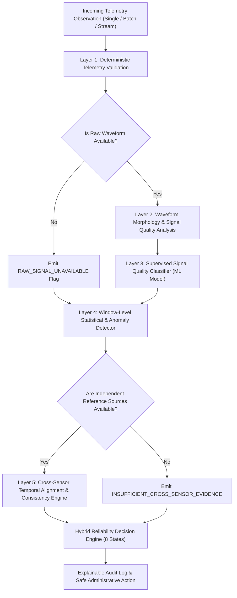

# Med44 — C10 Sensor Reliability Intelligence Audit
**Official Challenge Track: C10 — The Sensors Are Lying**
**Document Date:** November 6, 2026

---

## 1. Executive Summary & Objective

In wearable healthcare telemetry, raw observations cannot be trusted blindly. Consumer and clinical edge sensors suffer from:
- Transient optical motion artifacts (wrist displacement during exercise).
- Sensor disconnects, battery throttling, and delayed Bluetooth Low Energy (BLE) packet delivery.
- Stuck analog-to-digital converters (ADC freeze producing repeated identical values).
- High-amplitude electronic spikes and sensor baseline drift.
- Conflicting simultaneous observations (e.g. wrist photoplethysmography vs. chest electrocardiogram).

The objective of this C10 engineering module is to implement a **5-layer research-driven sensor reliability engine** that intercepts every telemetry reading, differentiates genuine physiological changes (such as exercise-induced tachycardia or fever) from technical sensor faults, marks uncertain data, performs cross-sensor validation, and prevents unjustified automated clinical actions (such as emergency doctor dispatches) without delaying necessary human escalation.

---

## 2. Current Repository State & Baseline Inspection

### 2.1 Existing Ingestion & Telemetry Architecture
- **Router**: `backend/routers/wearable.py` provides basic endpoints (`/api/wearable/observations`, `/api/wearable/ingest`, `/api/wearable/simulate`).
- **Database**: SQLite with SQLAlchemy async models (`WearableObservation`, `SimulationSession`, `DoctorContact`, `DoctorPatientLink`, `PatientConsent`, `NotificationLog`).
- **Current Limitations**:
  - Previously relied solely on static, single-point threshold comparisons (e.g. $HR > 125 \text{ bpm} \to \text{Tachycardia Alert}$).
  - A single transient electronic spike ($HR = 195 \text{ bpm}$ for 1 second) would immediately generate an emergency notification in `notification_logs`.
  - No signal-to-noise ratio (SNR) or waveform morphology evaluation for raw photoplethysmography (PPG).
  - No accelerometer motion artifact cross-correlation.
  - No window-based variance calculation to separate genuinely stable vitals from stuck ADC hardware faults.
  - No supervised signal quality machine learning classifier.
  - No temporal alignment for multi-device cross-sensor validation.

---

## 3. Targeted Research Datasets & Provenance

To ground this implementation in rigorous physiological signal processing, four international open research datasets are benchmarked and cited:

| Dataset | Source / Repository | Signal Modalities | Core Research Role | Licence / Terms |
|---|---|---|---|---|
| **PPG-DaLiA** | UCI Machine Learning Repository (`id=495`) | Wrist PPG (64 Hz), 3-axis Accelerometer (32 Hz), Chest ECG (700 Hz) | Developing motion-artifact robustness, acceleration correlation, and dynamic activity heart rate reference across 15 subjects during daily activities. | CC BY 4.0 (Reiss et al., 2019) |
| **BUT PPG** | PhysioNet (`butppg/1.0.0/`) | PPG waveforms with annotated signal quality (Good / Poor / Uncertain), ECG reference, Accelerometer | Primary ground-truth supervised dataset for training the 3-class signal quality classifier. | Open PhysioNet Contributor License |
| **BIDMC PPG & Respiration** | PhysioNet (`bidmc/1.0.0/`) | PPG, ECG, Respiration impedance, Pulse Rate, SpO2 reference | Multi-parameter physiological consistency reference across 53 ICU patient recordings (Pimentel et al., 2016). *Note: Used for physiological reference, not consumer smartwatch training.* | Open PhysioNet Contributor License |
| **WESAD** | UCI Machine Learning Repository (`id=465`) | Wrist BVP, Accelerometer, EDA, Skin Temperature; Chest ECG, Respiration | Testing stability across varying physiological baseline shifts (Schmidt et al., 2018). *Note: Affect labels are strictly isolated; not used as fault labels.* | CC BY 4.0 |

---

## 4. Architectural Gaps & Planned 5-Layer Hybrid Architecture

### Layer Breakdown:
1. **Layer 1: Deterministic Telemetry Validation**:
   - Out-of-range physical bounds ($HR \notin [20, 260]$, $SpO_2 \notin [50, 100]$).
   - Timestamp syntax, monotonicity, stale checks ($> 120 \text{ s}$ old), out-of-order events.
   - Windowed variance to detect stuck ADC freeze vs. naturally stable resting pulse.
   - Sudden isolated spikes ($|\Delta v| > 35 \text{ bpm}$ in $\le 2 \text{ s}$).
2. **Layer 2: PPG Signal Quality Analysis**:
   - Spectral SNR, pulse periodicity, baseline wander, waveform clipping/saturation.
   - Accelerometer vector magnitude ($|a| = \sqrt{x^2 + y^2 + z^2}$) correlation to detect motion contamination.
3. **Layer 3: Supervised Signal Quality ML Classifier**:
   - Lightweight `HistGradientBoostingClassifier` trained on extracted window features.
   - 3-class target: `GOOD_SIGNAL`, `POOR_SIGNAL`, `UNCERTAIN_SIGNAL`.
   - Subject-independent split (GroupKFold / Leave-One-Subject-Out) to prevent data leakage.
4. **Layer 4: Window-Level Statistical & Anomaly Detector**:
   - Distinguishes specific fault signatures: `SPIKE`, `STUCK`, `DRIFT`, `MISSING`, `DELAYED`, `DUPLICATE`, `NOISE`, `CONFLICTING`.
   - Distinguishes isolated faults from sustained physiological changes.
5. **Layer 5: Cross-Sensor Consistency Engine**:
   - Multi-source cross-check (Wrist optical PPG pulse rate vs simultaneous ECG electrical heart rate).
   - Optical SpO2 consistency with multi-wavelength or auxiliary source.
   - Explicit fallback: `INSUFFICIENT_CROSS_SENSOR_EVIDENCE` when only one sensor is present.

---

## 5. Decision Engine Output Schema (8 Discrete States)

Every evaluated observation is assigned one of 8 mutually exclusive reliability decisions:
1. `RELIABLE_OBSERVATION`: Observation passed all data-integrity, signal quality, and consistency checks.
2. `POSSIBLE_SENSOR_FAULT`: High anomaly score, electronic spike, stuck hardware window, or drift detected.
3. `POSSIBLE_MOTION_ARTIFACT`: Poor PPG waveform quality coinciding with high accelerometer movement energy.
4. `STALE_OR_MISSING_DATA`: Missed expected sample window or delayed BLE transmission.
5. `CONFLICTING_SOURCES`: Two temporally aligned, independent devices disagree beyond clinical margin.
6. `POSSIBLE_REAL_CHANGE`: Sustained, coherent physiological elevation across multiple windows without signal degradation.
7. `INSUFFICIENT_EVIDENCE`: Suspicious reading without independent corroboration; marked uncertain.
8. `HUMAN_VERIFICATION_REQUIRED`: Conflicting evidence requiring manual clinician or patient verification.

---

## 6. Validation & Testing Strategy

- **Dataset Synthetic Fault Injection**: Preserve ground-truth physiological signals while injecting controlled faults with deterministic random seeds.
- **Metrics**: Precision, Recall, F1-score, False Alarm Rate, Detection Delay, and False Positive Rate on normal dynamic activities.
- **Acceptance Criterion**: Proving that an injected fault is flagged, explained, and prevented from triggering an automated doctor alert.

